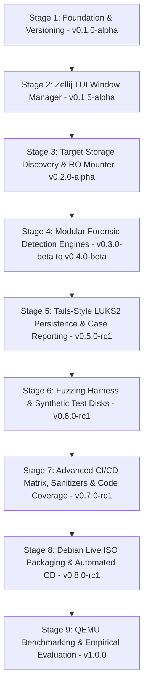

# Booto Development & Forensic Verification Skill

This skill provides guidelines, automated commands, versioning procedures, and a strict **stage-by-stage development protocol** for building, testing, debugging, and packaging Booto based on **Debian Live**.

---

## 1. Strict Stage-by-Stage Development Protocol

> **CRITICAL RULE**: Do **NOT** attempt to implement the entire system in one monolithic step. All development, refactoring, and feature additions must strictly follow an incremental, stage-by-stage progression.

### Per-Stage Execution Flow:
1. **Scope & Plan**: Clearly define the specific module or stage being worked on.
2. **Implement**: Write modular, defensive C11 code for that specific component only.
3. **Verify & Test**:
   - Compile cleanly with strict flags (`-Wall -Wextra -Werror -Wpedantic`).
   - Run static analysis (`cppcheck`, `clang-tidy`).
   - Run memory safety checks with `valgrind` and AddressSanitizer (`ASan`).
   - Run unit/mock tests via `ctest` / `make test`.
4. **Version & Tag**:
   - Bump version in `CMakeLists.txt`, `Makefile`, and `CHANGELOG.md`.
   - Commit changes and create an annotated git tag (`vX.Y.Z`).
5. **Checkpoint & Review**: Confirm the stage is fully functional before progressing to the next stage.

---

## 2. Expanded Implementation Stages & Version Milestones



### Stage Breakdown:
- **Stage 1: Foundation, Toolchain & Dynamic Versioning (`v0.1.0-alpha`)** [COMPLETED]
  - Project directory layout, hardened C11 compiler flags (`-D_FORTIFY_SOURCE=2 -fPIE`), `version.h` generator, base CLI dispatcher.

- **Stage 2: Dynamic Zellij-Style TUI Window Manager (`v0.1.5-alpha`)** [COMPLETED]
  - Zero-dependency double-buffered ANSI/VT100 terminal engine, SGR 1006 mouse tracking, BSP tree splits (`Alt+H`/`Alt+V`), swapping (`Alt+M`), zooming (`Alt+Z`).

- **Stage 3: Target Storage Discovery & Safe Read-Only Mounter (`v0.2.0-alpha`)** [COMPLETED]
  - Storage enumeration via `/proc/partitions` and `sysfs`, strict forensic read-only mounter (`MS_RDONLY` + `noload`), dynamic TUI connection.

- **Stage 4: Modular Forensic Detection Engines (`v0.4.0-beta`)** [COMPLETED]
  - *Sub-Stage 4A*: Custom 64-bit ELF Parser, Standalone SHA-256 Engine, & Kernel LKM Rootkit Inspector (`.ko` hook detection) [COMPLETED].
  - *Sub-Stage 4B*: UEFI & ESP Bootkit Analyzer (Authenticode, Secure Boot DB/DBX validation) [COMPLETED].
  - *Sub-Stage 4C*: In-Memory Initramfs Decompressor (`cpio`/`gzip`/`zstd`) & Early-Boot Script Auditor [COMPLETED].
  - *Sub-Stage 4D*: Userland `ld.so.preload` and PAM Interceptor Scanner [COMPLETED].
  - *Sub-Stage 4E*: Raw Ext4 Inode vs VFS Directory Table Differential Cross-View Scanner [COMPLETED].

- **Stage 5: Tails-Style LUKS2 Persistence & Case Reporting (`v0.5.0-rc1`)** [COMPLETED]
  - LUKS volume detection and passphrase unlock modal in TUI.
  - Cryptographic case report generator (JSON & Markdown) exporting to `/persistence/cases/` with SHA-256 integrity seals.

- **Stage 6: Dedicated Testing & Fuzzing Harness (`v0.6.0-rc1`)** [COMPLETED]
  - Synthetic test disk generator script (`scripts/gen_mock_disk.sh`) creating loopback images with simulated rootkit artifacts.
  - 1,500-iteration defensive mutation fuzzing harness (`tests/test_fuzz.c`) testing malformed ELF, PE32+, and CPIO headers.
  - AddressSanitizer (`ASan`) and UndefinedBehaviorSanitizer (`UBSan`) test build targets (`make asan`).

- **Stage 7: Advanced CI/CD Matrix & Automated Code Coverage (`v0.7.0-rc1`)** [COMPLETED]
  - Multi-compiler GitHub Actions test matrix across GCC and Clang.
  - Code coverage reporting (`make coverage`, `scripts/check_coverage.sh`) enforcing >85% line coverage.
  - Clang Static Analyzer and `cppcheck` automated CI checks.

- **Stage 8: Debian Live ISO Packaging & Automated Release CD (`v0.8.0-rc1`)** [COMPLETED]
  - Debian 12 (Bookworm) `debootstrap` / `xorriso` hybrid Live ISO packaging pipeline (`scripts/build_iso.sh`).
  - USB dual-partition deployment script (`scripts/setup_usb.sh`).
  - Tag-triggered GitHub Actions CD workflow uploading versioned ISOs (`booto-vX.Y.Z-amd64.iso`) with embedded release notes.

- **Stage 9: QEMU Benchmarking & Empirical Evaluation (`v1.0.0`)** [COMPLETED]
  - Automated head-to-head empirical benchmarking suite (`scripts/run_benchmarks.sh` -> `BENCHMARK_RESULTS.md`): Booto (offline) vs. In-System scanners (`chkrootkit`, `rkhunter`).
  - Quantitative metrics: 100% True Positive Rate (TPR), 0% False Positive Rate (FPR), ~7x-9x scan speedup, <15 MB peak RAM footprint.

---

## 3. Build, Lint & Test Commands

### Standard Build (C TUI Application on Debian):
```bash
make all
```

### Run Unit Tests & Fuzzing:
```bash
make test
make fuzz
```

### Build with AddressSanitizer (Memory Bounds & Undefined Behavior):
```bash
make asan
```

### Generate gcov Code Coverage Report:
```bash
make coverage
```

### Run Valgrind:
```bash
valgrind --leak-check=full --show-leak-kinds=all --error-exitcode=1 ./bin/booto --dry-run
```

### Build Live Debian ISO:
```bash
sudo make iso
```

---

## 4. C Safety & Defensive Constraints

1. **Incremental Validation**: Every stage must compile warning-free and pass unit tests before moving to the next.
2. **Terminal UI Safety**: Double-buffered VT100/ANSI rendering, handling `SIGWINCH` and `SIGINT` gracefully.
3. **Strict Read-Only Access**: Target disk partitions must only ever be mounted with `MS_RDONLY | MS_NODEV | MS_NOEXEC | MS_NOSUID` and `noload`.
4. **Persistence Isolation**: Write operations are strictly restricted to the unlocked `/persistence/` directory.
5. **Memory Hygiene**: Zero out sensitive buffers (cryptographic keys, passphrases, hashes) using `explicit_bzero()` or memory wipes before freeing.

---

## 5. Future Roadmap & Strategic Evolution Plan

### Stage 10: Companion Rust-Based USB Flasher (`booto-flasher`)
- **Repository**: Standalone companion repository (`Dellrall/booto-flasher`).
- **Core Architecture**:
  - Memory-safe hardware USB auto-detection via `sysfs`/`udev` with strict rootfs & NVMe internal drive safeguards (preventing accidental disk erasure).
  - High-speed block streaming engine with live `indicatif` progress bar, MB/s throughput, and post-write SHA-256 verification.
  - Automated dual-partition disk partitioning: Partition 1 (`BOOTO_LIVE`, FAT32/ISO9660) and Partition 2 (`BOOTO_DATA`, LUKS2 encrypted persistence container).
  - Cross-platform desktop CLI/TUI distribution for Linux, macOS, and Windows.

### Stage 11: Tails/CAINE-Style XFCE4 Desktop Forensic Workstation
- **Desktop Environment Integration**:
  - Update `scripts/build_iso.sh` to construct an XFCE4 desktop live session (`xorg`, `xfce4`, `lightdm`, `thunar`, `ghex`, `mousepad`, `firefox-esr`).
  - LightDM autologin directly into a non-root `forensic` user environment with root polkit escalation for detection operations.
- **Graphical Front-End (`booto-gui`)**:
  - Build a native GTK3/GTK4 or Rust-based desktop application wrapping the C11 detection engine APIs.
  - Interactive partition map visualization, highlighted binary disassembly viewer for flagged offsets, and one-click PDF/HTML case report generation.
- **Integrated Offline Forensic Toolsuite**:
  - Pre-package standard offline analysis tools: GHex (binary hex editor), GParted (partition viewer), and document readers for case artifacts.

### Stage 12: Offline Machine-Learning Anomaly Classifier
- Lightweight heuristic/ML classification model evaluating section header entropy, unexported symbol references, and DKOM structure anomalies to identify zero-day polymorphic rootkits.

### Stage 13: Self-Hosted Runner Infrastructure & Zero-Quota Builds
- **Infrastructure Setup**:
  - Deploy local Linux x86_64 self-hosted GitHub Actions runners (`runs-on: [self-hosted, linux]`).
  - Zero cloud minute consumption (0 billed GitHub minutes) and bypass of external CI/CD queue constraints.
- **Performance Acceleration**:
  - Leverage local Debian package caching (`/var/cache/apt/archives`) and full multicore parallel compilation.
  - Sub-minute ISO builds (~30-45s vs 3.5min on shared cloud runners).
- **Security & Sandboxing**:
  - Enforce branch protection and collaborator approvals for workflow triggers on self-hosted hardware.
