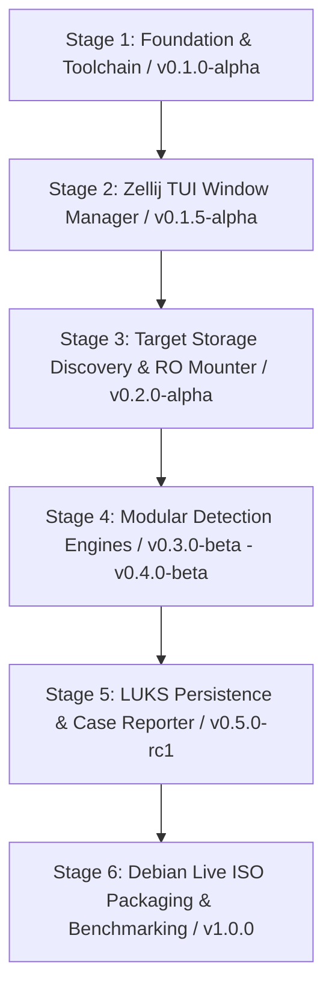

# Booto Development & Forensic Verification Skill

This skill provides guidelines, automated commands, versioning procedures, and a strict **stage-by-stage development protocol** for building, testing, debugging, and packaging Booto based on **Debian Live**.

---

## 1. Strict Stage-by-Stage Development Protocol

> **CRITICAL RULE**: Do **NOT** attempt to implement the entire system in one monolithic step. All development, refactoring, and feature additions must strictly follow an incremental, stage-by-stage progression.

### Per-Stage Execution Flow:
1. **Scope & Plan**: Clearly define the specific module or stage being worked on.
2. **Implement**: Write modular, defensive C11 code for that specific component only.
3. **Verify & Test**:
   - Compile cleanly with strict flags (`-Wall -Wextra -Werror -Wpedantic`).
   - Run static analysis (`cppcheck`, `clang-tidy`).
   - Run memory safety checks with `valgrind`.
   - Run unit/mock tests via `ctest`.
4. **Version & Tag**:
   - Bump version in `CMakeLists.txt` / `CHANGELOG.md`.
   - Commit changes and create an annotated git tag (`vX.Y.Z`).
5. **Checkpoint & Review**: Confirm the stage is fully functional before progressing to the next stage.

---

## 2. Defined Implementation Stages & Version Milestones



### Stage Breakdown:
- **Stage 1: Foundation, Toolchain & CI/CD (`v0.1.0-alpha`)**
  - Project directory layout (`include/`, `src/`, `tests/`, `scripts/`, `.github/workflows/`).
  - Strict `CMakeLists.txt` with hardening flags (`-fstack-protector-strong -D_FORTIFY_SOURCE=2`).
  - Automated `version.h` generation from CMake + Git commit hash.
  - Base error handling, logging, CLI argument parser, and GitHub Actions CI workflow.

- **Stage 2: Dynamic Zellij-Style TUI Window Manager (`v0.1.5-alpha`)**
  - Binary Space Partitioning (BSP) window tree in `src/tui/wm.c`.
  - Pane splitting (`Alt+H`/`Alt+V`), moving/swapping (`Alt+M`), zooming (`Alt+Z`), and resizing (`Alt+[`/`Alt+]`).
  - Mouse click/drag focus and terminal resize (`SIGWINCH`) handling.

- **Stage 3: Target Storage Discovery & Read-Only Mounter (`v0.2.0-alpha`)**
  - Storage enumeration via `libblkid` / `sysfs` (identifying NVMe, SATA, USB).
  - Forensic read-only mounting (`MS_RDONLY | MS_NODEV | MS_NOEXEC | MS_NOSUID` with `noload`).
  - Storage selector UI panel integration.

- **Stage 4: Modular Forensic Detection Engines (`v0.3.0-beta` – `v0.4.0-beta`)**
  - *Sub-Stage 4A*: Custom ELF Parser & Kernel LKM Inspector (`.ko` module symbol & hook checks).
  - *Sub-Stage 4B*: UEFI & ESP Bootkit Analyzer (Authenticode, Secure Boot DB/DBX hash validation).
  - *Sub-Stage 4C*: In-Memory Initramfs Decompressor & Early-Boot Script Auditor.
  - *Sub-Stage 4D*: Userland `ld.so.preload` and PAM Interceptor Scanner.
  - *Sub-Stage 4E*: Raw Ext4 Inode vs VFS Directory Table Differential Scanner.

- **Stage 5: Tails-Style LUKS2 Persistence & Case Reporting (`v0.5.0-rc1`)**
  - LUKS volume detection and passphrase unlock modal in TUI.
  - Cryptographic case report generator (JSON & Markdown) exporting to `/persistence/cases/`.

- **Stage 6: Debian Live ISO Packaging & QEMU Validation (`v1.0.0`)**
  - `build_iso.sh` pipeline using Debian Live (`live-build` / `debootstrap`, `toram`, `forensic` flags).
  - `setup_usb.sh` USB partitioner (Debian Live ISO to P1, LUKS2 to P2).
  - GitHub Actions tag-triggered release workflow uploading `booto-vX.Y.Z-x86_64.iso`.
  - QEMU virtualized test harness with synthetic rootkit samples for benchmark evaluation.

---

## 3. Automated Versioning Procedures

### Single Source of Truth (`CMakeLists.txt` + `version.h.in`):
Version information is defined once in `CMakeLists.txt` and dynamically injected into generated headers on build:
```c
#include "version.h"
// Access: BOOTO_VERSION_STRING, BOOTO_GIT_HASH, BOOTO_BUILD_DATE
```

### Automated Milestone Release / Version Bump Protocol:
When completing a milestone stage:
```bash
# 1. Update version in CMakeLists.txt (e.g. 0.2.0) and CHANGELOG.md
# 2. Run static analysis & test suite
cd build && ctest --output-on-failure
# 3. Create annotated Git tag
git tag -a v0.2.0 -m "Release v0.2.0: Target Storage Discovery and Safe RO Mounter"
# 4. Push tag (triggers GitHub Actions release workflow if remote is configured)
git push origin v0.2.0
```

---

## 4. Build, Lint & Packaging Commands

### Standard Build (C TUI Application on Debian):
```bash
# Install dependencies on Debian:
sudo apt-get install -y build-essential cmake libncurses-dev libblkid-dev libudev-dev cppcheck clang-tidy valgrind live-build xorriso

mkdir -p build && cd build
cmake -DCMAKE_BUILD_TYPE=Debug ..
make -j$(nproc)
```

### Build the Debian Live Bootable ISO (`booto-live.iso`):
```bash
# Build the ISO image from project root
make iso
# Or run the script directly:
sudo ./scripts/build_iso.sh
```

### Static Analysis & Linting:
Run static analysis at each stage before committing:
```bash
# Run cppcheck
cppcheck --enable=all --inconclusive --suppress=missingIncludeSystem src/ include/

# Run clang-tidy
clang-tidy src/*.c src/tui/*.c -- -Iinclude -Ibuild/generated
```

---

## 5. Testing & Verification Workflows

### Running TUI in Local Test Mode (Mock Panels & Drives):
```bash
./build/booto --mock-drives --dry-run
```

### Running Unit Tests (ctest):
```bash
cd build && ctest --output-on-failure
```

### Memory Leak & Bounds Checks (Valgrind):
```bash
valgrind --leak-check=full --show-leak-kinds=all --track-origins=yes ./build/booto --scan-dir /path/to/mock_rootfs
```

### QEMU Full-Stack Live ISO Test:
```bash
./scripts/run_qemu.sh
```

---

## 6. Physical USB Deployment

Flash the ISO to partition 1 and create a LUKS2 encrypted persistence volume on partition 2 of a USB stick:
```bash
sudo ./scripts/setup_usb.sh /dev/sdX
```

---

## 7. C Safety & Defensive Constraints

1. **Incremental Validation**: Every stage must compile warning-free and pass unit tests before moving to the next.
2. **Terminal UI Safety**: Handle `SIGWINCH` and `SIGINT` gracefully to avoid terminal corruption.
3. **Strict Read-Only Access**: Target disk partitions must only ever be mounted with `MS_RDONLY | MS_NODEV | MS_NOEXEC | MS_NOSUID` and `noload`.
4. **Persistence Isolation**: Write operations are strictly restricted to the unlocked `/persistence/` directory.
5. **Memory Hygiene**: Zero out sensitive buffers (cryptographic keys, passphrases, hashes) using `explicit_bzero()` before freeing.
