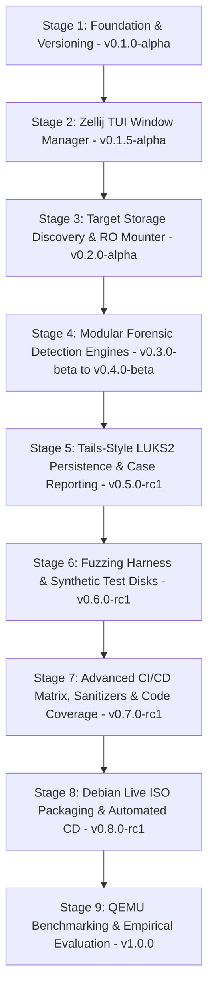

# Booto Development & Forensic Verification Skill

This skill provides guidelines, automated commands, versioning procedures, and a strict **stage-by-stage development protocol** for building, testing, debugging, and packaging Booto based on **Debian Live**.

---

## 1. Strict Stage-by-Stage Development Protocol

> **CRITICAL RULE**: Do **NOT** attempt to implement the entire system in one monolithic step. All development, refactoring, and feature additions must strictly follow an incremental, stage-by-stage progression.

### Per-Stage Execution Flow:
1. **Scope & Plan**: Clearly define the specific module or stage being worked on.
2. **Implement**: Write modular, defensive C11 code for that specific component only.
3. **Verify & Test**:
   - Compile cleanly with strict flags (`-Wall -Wextra -Werror -Wpedantic`).
   - Run static analysis (`cppcheck`, `clang-tidy`).
   - Run memory safety checks with `valgrind` and AddressSanitizer (`ASan`).
   - Run unit/mock tests via `ctest` / `make test`.
4. **Version & Tag**:
   - Bump version in `CMakeLists.txt`, `Makefile`, and `CHANGELOG.md`.
   - Commit changes and create an annotated git tag (`vX.Y.Z`).
5. **Checkpoint & Review**: Confirm the stage is fully functional before progressing to the next stage.

---

## 2. Expanded Implementation Stages & Version Milestones



### Stage Breakdown:
- **Stage 1: Foundation, Toolchain & Dynamic Versioning (`v0.1.0-alpha`)** [COMPLETED]
  - Project directory layout, hardened C11 compiler flags (`-D_FORTIFY_SOURCE=2 -fPIE`), `version.h` generator, base CLI dispatcher.

- **Stage 2: Dynamic Zellij-Style TUI Window Manager (`v0.1.5-alpha`)** [COMPLETED]
  - Zero-dependency double-buffered ANSI/VT100 terminal engine, SGR 1006 mouse tracking, BSP tree splits (`Alt+H`/`Alt+V`), swapping (`Alt+M`), zooming (`Alt+Z`).

- **Stage 3: Target Storage Discovery & Safe Read-Only Mounter (`v0.2.0-alpha`)** [COMPLETED]
  - Storage enumeration via `/proc/partitions` and `sysfs`, strict forensic read-only mounter (`MS_RDONLY` + `noload`), dynamic TUI connection.

- **Stage 4: Modular Forensic Detection Engines (`v0.3.0-beta` – `v0.4.0-beta`)** [IN PROGRESS]
  - *Sub-Stage 4A*: Custom 64-bit ELF Parser, Standalone SHA-256 Engine, & Kernel LKM Rootkit Inspector (`.ko` hook detection) [COMPLETED].
  - *Sub-Stage 4B*: UEFI & ESP Bootkit Analyzer (Authenticode, Secure Boot DB/DBX validation) [NEXT].
  - *Sub-Stage 4C*: In-Memory Initramfs Decompressor (`cpio`/`gzip`/`zstd`) & Early-Boot Script Auditor.
  - *Sub-Stage 4D*: Userland `ld.so.preload` and PAM Interceptor Scanner.
  - *Sub-Stage 4E*: Raw Ext4 Inode vs VFS Directory Table Differential Cross-View Scanner.

- **Stage 5: Tails-Style LUKS2 Persistence & Case Reporting (`v0.5.0-rc1`)**
  - LUKS volume detection and passphrase unlock modal in TUI.
  - Cryptographic case report generator (JSON & Markdown) exporting to `/persistence/cases/`.

- **Stage 6: Dedicated Testing & Fuzzing Harness (`v0.6.0-rc1`)**
  - Synthetic test disk generator script (`scripts/gen_mock_disk.sh`) creating loopback images with simulated rootkit artifacts.
  - Binary fuzzing harness testing malformed/corrupted ELF and PE headers against parser crash resilience.
  - AddressSanitizer (`ASan`) and UndefinedBehaviorSanitizer (`UBSan`) test build targets (`make asan`).

- **Stage 7: Advanced CI/CD Matrix & Automated Code Coverage (`v0.7.0-rc1`)**
  - Multi-compiler GitHub Actions test matrix (GCC 11/12/13, Clang 14/16).
  - Code coverage reporting (`gcov` / `lcov` / Codecov) with badge generation.
  - Clang Static Analyzer (`scan-build`) automated check.

- **Stage 8: Debian Live ISO Packaging & Automated Release CD (`v0.8.0-rc1`)**
  - Debian `live-build` / `xorriso` ISO packaging pipeline (`build_iso.sh`).
  - USB dual-partition deployment script (`setup_usb.sh`).
  - Tag-triggered GitHub Actions CD workflow uploading `booto-vX.Y.Z-x86_64.iso` + checksums.

- **Stage 9: QEMU Benchmarking & Empirical Evaluation (`v1.0.0`)**
  - Automated head-to-head benchmarking script (`scripts/run_benchmarks.sh`): Booto (offline) vs. In-System scanners (`chkrootkit`, `rkhunter`).
  - Quantitative metrics extraction: Detection rate (100% TPR), False Positive Rate (0% FPR), Scan speed (MB/s), RAM consumption for the final dissertation/defense.

---

## 3. Build, Lint & Test Commands

### Standard Build (C TUI Application on Debian):
```bash
make all
```

### Run Unit Tests:
```bash
make test
```

### Build with AddressSanitizer (Memory Bounds & Leak Fuzzing):
```bash
make asan && ./build/test_elf_analyzer
```

### Run Valgrind:
```bash
valgrind --leak-check=full --show-leak-kinds=all --error-exitcode=1 ./bin/booto --dry-run
```

### Build Live Debian ISO (`booto-live.iso`):
```bash
make iso
```

---

## 4. C Safety & Defensive Constraints

1. **Incremental Validation**: Every stage must compile warning-free and pass unit tests before moving to the next.
2. **Terminal UI Safety**: Handle `SIGWINCH` and `SIGINT` gracefully to avoid terminal corruption.
3. **Strict Read-Only Access**: Target disk partitions must only ever be mounted with `MS_RDONLY | MS_NODEV | MS_NOEXEC | MS_NOSUID` and `noload`.
4. **Persistence Isolation**: Write operations are strictly restricted to the unlocked `/persistence/` directory.
5. **Memory Hygiene**: Zero out sensitive buffers (cryptographic keys, passphrases, hashes) using `explicit_bzero()` before freeing.
